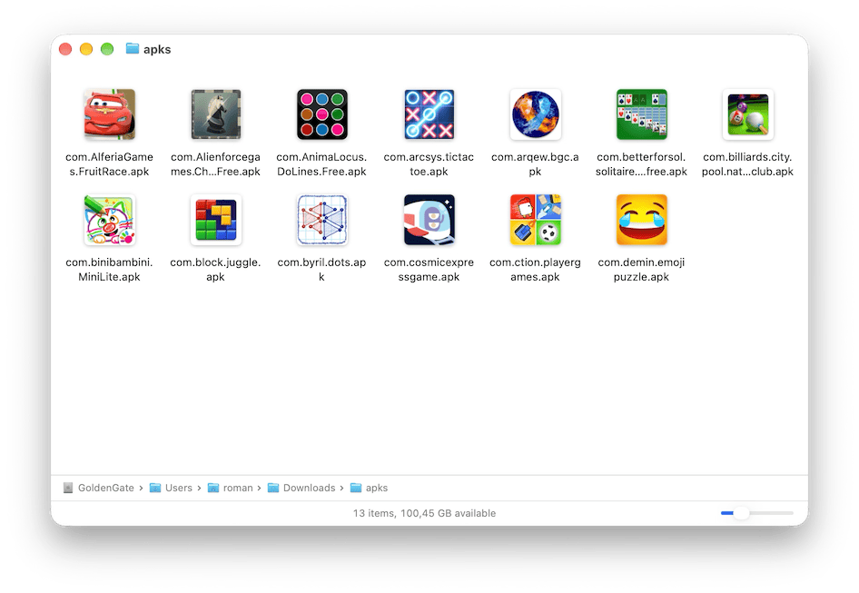
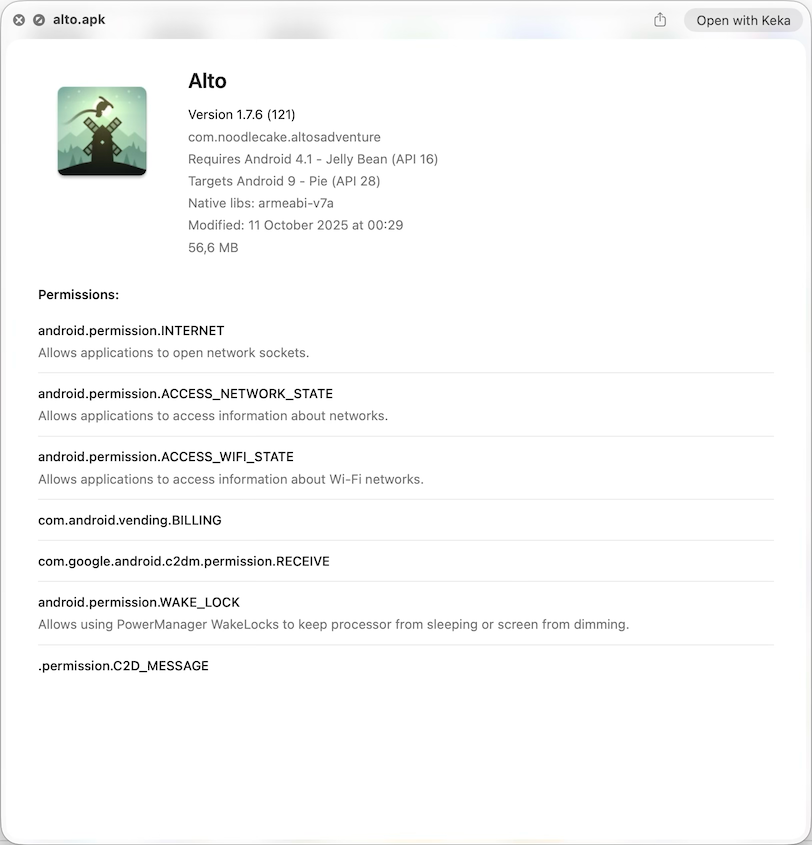

QuickLookAPK
============
A Quick Look plugin for Android packages, updated to be compatible with new macOS Quick Look Preview Extension and Thumbnail Extension APIs (macOS 12+). Based on QuickLookAPK by Hezi Cohen (https://github.com/hezi/QuickLookAPK), rewritten in Swift with no dependencies and without calling external tools.

## Installation

* Unpack QuickLookAPK.zip or build the project, move QuickLookAPK to `/Applications`
* Run the app, open Extension Settings in System Preferences, make sure `APK Preview` and `APK Thumbnail` are enabled for Extensions - Quick Look

## Screenshot




## Troubleshooting

### Check Quick Look extension registration
Every copy of the app on disk (Xcode builds, archives, downloads) can register its own extensions, and macOS may pick an outdated one.

```sh
# Extensions in use: one copy per extension, the one macOS picked (+ enabled, - disabled)
pluginkit -m -A -v | grep QuickLookAPK

# All registered copies, including duplicates from Xcode archives and builds
pluginkit -m -A -D -v | grep QuickLookAPK

# All app copies known to Launch Services
/System/Library/Frameworks/CoreServices.framework/Frameworks/LaunchServices.framework/Support/lsregister -dump | grep -E "^path:.*QuickLookAPK\.app"
```

### Remove a stale registration
```sh
# Unregister an app copy together with its extensions
/System/Library/Frameworks/CoreServices.framework/Frameworks/LaunchServices.framework/Support/lsregister -u "/path/to/QuickLookAPK.app"

# Or remove a single extension
pluginkit -r "/path/to/QuickLookAPK.app/Contents/PlugIns/APK Preview.appex"
```

Deleting the app copy from disk (and emptying the Trash) also removes its registration. To register the installed app again, run `/Applications/QuickLookAPK.app` once.

### Reset Quick Look and test
```sh
# Reload Quick Look extensions and clear the thumbnail cache
qlmanage -r
qlmanage -r cache

# Show a preview / generate a thumbnail for a file
qlmanage -p file.apk
qlmanage -t -s 512 file.apk
```

### Other
* To compress the notarized build run `ditto -c -k --keepParent QuickLookAPK.app QuickLookAPK.zip` on the exported app.
